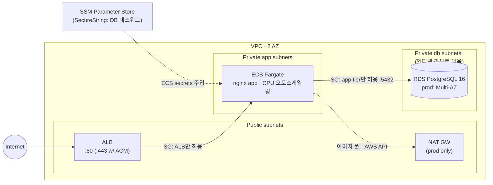

# terraform-aws-3tier

[](https://github.com/doxgxxn/terraform-aws-3tier/actions/workflows/pr-checks.yml)
[](https://github.com/doxgxxn/terraform-aws-3tier/actions/workflows/deploy.yml)

AWS 3-tier 웹 인프라(ALB → ECS Fargate → RDS PostgreSQL)를 Terraform으로 구축·운영하는 레포입니다.
모듈화된 코드 베이스 위에 **dev/prod 환경 분리**, **S3 원격 상태(네이티브 잠금)**, **GitHub OIDC 키리스 CI/CD**,
**tflint + tfsec 품질 게이트**, **PR plan 코멘트 → main 머지 시 apply** 파이프라인까지 포함합니다.

## 아키텍처



보안 그룹이 체인으로 좁혀집니다: 인터넷 → ALB(:80/:443만) → 태스크(ALB SG에서만) → RDS(태스크 SG에서만, :5432). DB 서브넷에는 인터넷 라우트 자체가 없습니다.

## 디렉토리 구조

```
├── bootstrap/            # 1회 실행: 상태 버킷 + GitHub OIDC 롤 (키리스 CI의 기반)
├── modules/
│   ├── network/          # VPC, 3계층 서브넷(public/app/db), IGW, NAT 토글
│   ├── alb/              # ALB, SG, 타깃그룹, HTTP(S) 리스너 (ACM ARN 주면 443+리다이렉트)
│   ├── ecs-service/      # 클러스터, 태스크 정의, 서비스, IAM 롤 분리, 오토스케일링, 로그
│   └── rds/              # PostgreSQL, 서브넷 그룹, SG, SSM SecureString 패스워드
├── envs/
│   ├── dev/              # 비용 최소화: NAT 없음, 단일 AZ RDS, 에페메럴 전제
│   └── prod/             # 가용성 우선: NAT, Multi-AZ RDS, 태스크 2+, 삭제 보호
└── .github/workflows/    # pr-checks(품질 게이트+plan 코멘트) / deploy / destroy
```

## 핵심 설계 결정

- **원격 상태 = S3 + 네이티브 lockfile** — Terraform 1.10+의 `use_lockfile = true`를 사용해 DynamoDB 잠금 테이블 없이 상태 잠금을 처리합니다(DynamoDB 방식은 deprecated 수순). 버킷 이름은 계정 종속이라 커밋하지 않고 `-backend-config`로 주입합니다.
- **키리스 CI (GitHub OIDC)** — 장기 액세스 키를 GitHub Secrets에 넣지 않습니다. `bootstrap/`이 OIDC IdP와 이 레포 전용 trust policy를 가진 롤을 만들고, CI는 매 실행마다 단기 자격증명을 받습니다. IAM 권한은 `t3t-*` 프리픽스로 스코프.
- **시크릿은 코드·상태 외부로** — DB 마스터 패스워드는 `random_password`로 생성해 SSM SecureString에 저장하고, ECS 태스크 정의의 `secrets`(valueFrom)로 런타임에만 주입합니다. tfvars·레포·태스크 정의 JSON 어디에도 평문이 없습니다.
- **dev/prod는 같은 모듈, 다른 자세** — 환경 차이는 전부 모듈 입력으로 표현됩니다.

| | dev | prod |
|---|---|---|
| NAT 게이트웨이 | 없음 (태스크가 public 서브넷 + public IP, 인그레스는 여전히 ALB SG만) | 단일 NAT (예산 시 AZ당 NAT 전환) |
| ECS 태스크 | 1개 (max 2) | 2개+ 2AZ (max 4), CPU 타깃 트래킹 |
| RDS | db.t4g.micro 단일 AZ, 최종 스냅샷 생략 | Multi-AZ, 7일 백업, 삭제 보호, 최종 스냅샷 |
| 포지셔닝 | 에페메럴 (apply → 검증 → destroy) | 상시 운영 가정 |

- **tfsec 예외는 전부 근거 주석** — 공개 ALB, 데모용 CMK 미사용 등 의도된 예외는 `#tfsec:ignore:<rule> -- 사유` 형태로 코드에 남겨 스캐너를 끄지 않고 결정을 문서화합니다.

## CI/CD 파이프라인

**PR → main:** `fmt` / `validate`(env·bootstrap 매트릭스) / `tflint`(recommended preset + AWS ruleset) / `tfsec`(MEDIUM+, 루트 모듈별 매트릭스)가 항상 실행됩니다. AWS 자격(레포 변수 `AWS_ROLE_ARN`)이 등록돼 있으면 env별 `terraform plan`이 실행되고 결과가 **PR 코멘트로 업서트**됩니다(env별 스티키 코멘트).

**main 머지:** `deploy.yml`이 dev에 apply → `prod` environment(필수 리뷰어 설정 시 수동 승인 게이트)를 거쳐 prod에 apply. 동시 배포는 `concurrency`로 직렬화됩니다.

**철수:** `destroy.yml`(workflow_dispatch)로 환경 단위 teardown — 에페메럴 dev의 비용 통제 수단입니다.

## 시작하기

```bash
# 1. 기반 생성 (로컬 관리자 자격증명, 1회)
cd bootstrap && terraform init && terraform apply

# 2. 출력 2개를 GitHub 레포 변수로 등록
#    tf_state_bucket -> TF_STATE_BUCKET / ci_role_arn -> AWS_ROLE_ARN
gh variable set TF_STATE_BUCKET -b "<tf_state_bucket>"
gh variable set AWS_ROLE_ARN -b "<ci_role_arn>"

# 3. 이후는 PR 플로우: 브랜치 → PR(plan 코멘트 확인) → 머지(자동 apply)
# 로컬에서 직접 돌릴 때:
cd envs/dev
terraform init -backend-config="bucket=<TF_STATE_BUCKET>"
terraform plan
```

## 비용

0원 운영이 기본 전제입니다.

- **dev를 에페메럴로 운용** — apply로 올려 검증·증빙 후 바로 destroy. 시간 과금 리소스(ALB·Fargate·RDS)는 수 시간 기준 수백 원 미만이며, 프리티어 계정(가입 12개월)에서는 ALB 750h/월·RDS db.t4g.micro 750h/월·20GiB 스토리지가 무료 범위입니다.
- Fargate는 프리티어가 없어 상시 가동 시 태스크 1개(0.25 vCPU/0.5GB)당 약 $9/월 — dev를 상시로 두지 않는 이유입니다.
- NAT 게이트웨이(~$32/월)는 dev에서 제거하고 트레이드오프(태스크 public IP, 인그레스는 SG로 차단 유지)를 코드 주석으로 남겼습니다.
- VPC·IGW·SG·SSM 스탠다드 파라미터·CloudWatch 소량 로그는 상시 무료입니다.

## 로컬 품질 체크

```bash
terraform fmt -check -recursive
terraform -chdir=envs/dev init -backend=false && terraform -chdir=envs/dev validate
tflint --recursive --config "$(pwd)/.tflint.hcl"
tfsec envs/dev --minimum-severity MEDIUM
```

## License

[MIT](LICENSE)
